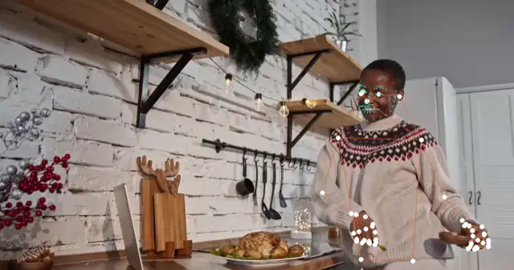

# rtmpose-rs

[RTMPose](https://github.com/open-mmlab/mmpose/tree/main/projects/rtmpose)
human pose estimation in Rust. Inference runs on ONNX Runtime through
[`ort`](https://github.com/pykeio/ort), with hardware acceleration where it is
available (CUDA, CoreML, DirectML).

- RTMDet-nano person detection.
- RTMPose body tracking: 17 COCO keypoints (RTMPose-m, RTMPose-l).
- RTMW whole-body tracking: 133 COCO-WholeBody keypoints covering body, feet,
  face and hands (RTMW-m, RTMW-l).
- A multi-person tracker that reuses each person's previous frame to place the
  next crop, runs the detector only when it needs to, and keeps a stable
  `PoseId` per person.
- egui live camera demos.

All outputs are 2D image coordinates; `z` is always 0.

<p align="center">
  
  <br>
  <sub>Video by <a href="https://www.pexels.com/video/woman-dancing-in-front-of-a-laptop-5974518/">Katrin Bolovtsova</a> on Pexels.</sub>
</p>

## Quick start

The ONNX models are not in git. They live on Hugging Face at
[michele-xilo/rtmpose-rs](https://huggingface.co/michele-xilo/rtmpose-rs); pull them into `models/` once,
before running the demos, the examples or `just test-models`:

```bash
uv tool install huggingface_hub        # installs the `hf` CLI
hf auth login                          # the model repo is private for now
just get-models                        # downloads into models/
```

Then run a demo:

```bash
just camera-pose-rtm                   # live camera, body
just camera-pose-rtmw                  # live camera, whole body
```

## Usage

```toml
[dependencies]
rtmpose = { git = "https://github.com/michele-xilo/rtmpose-rs" }
```

```rust
use rtmpose::shared::types::ModelSize;
use rtmpose::tracker::TrackerTrait;
use rtmpose::{PoseTrackerOptions, RtmPoseTracker};

let options = PoseTrackerOptions::new(ModelSize::Medium, "./models").with_max_n_poses(2);
let mut tracker = RtmPoseTracker::new(options)?;
let frame = image::open("people.jpg")?;
for pose in tracker.track(&frame)?.into_iter().flatten() {
    println!("{} keypoints, mean confidence {:.2}", pose.pixel_landmarks.len(), pose.average_confidence);
}
```

`RtmwPoseTracker` has the same API and returns 133 keypoints per person; the
index ranges for body, feet, face and hands are in `rtmpose::wholebody::config`.
`draw_rtm_predictions_on_image` and `draw_rtmw_predictions_on_image` render
results. The `serde` feature derives `Serialize` on the result types.

## Models

No weights ship with this repository. Pull them from
[michele-xilo/rtmpose-rs](https://huggingface.co/michele-xilo/rtmpose-rs) into `models/` with the
[`hf` CLI](https://huggingface.co/docs/huggingface_hub/guides/cli). The
Hugging Face repo is private for now, so run `hf auth login` first:

```bash
just get-models
```

To get them from upstream instead, download the ONNX exports from the
[RTMPose model zoo](https://github.com/open-mmlab/mmpose/tree/main/projects/rtmpose)
(the "onnx" SDK archives) or export the checkpoints yourself with
[MMDeploy](https://github.com/open-mmlab/mmdeploy), then put them in `models/`
under these names:

| Model | File | Picked by |
|---|---|---|
| RTMDet-nano (person) | `rtmdet_nano_person.onnx` | always (detector) |
| RTMPose-m, 256x192, AIC + COCO | `rtmpose_m_simcc_aic_coco_256x192.onnx` | `RtmPoseTracker`, `ModelSize` up to `Full` |
| RTMPose-l, 256x192, AIC + COCO | `rtmpose_l_simcc_aic_coco_256x192.onnx` | `RtmPoseTracker`, `Large`, `Heavy` |
| RTMW-m, 256x192, Cocktail14 | `rtmw_m_simcc_cocktail14_256x192.onnx` | `RtmwPoseTracker`, `Nano`, `Lite` |
| RTMW-l, 256x192, Cocktail14 | `rtmw_l_simcc_cocktail14_256x192.onnx` | `RtmwPoseTracker`, `Medium` and up |

The pose models take a `1x3x256x192` input named `input` and return `simcc_x`
and `simcc_y`. The detector takes `1x3x320x320` and returns `dets`
(`[x1, y1, x2, y2, score]`) and `labels`. These are the tensor names of the
standard MMDeploy ONNX Runtime export; check yours with
[Netron](https://netron.app) if loading fails.

The MMPose code and checkpoints are released under the
[Apache License 2.0](https://github.com/open-mmlab/mmpose/blob/main/LICENSE).
The checkpoints were trained on public datasets (COCO, AI Challenger and, for
RTMW, the fourteen datasets of Cocktail14), some of which carry their own
terms; check them before commercial use.

## Examples

```bash
just example-pose-rtm path/to/photo.jpg    # writes assets/outputs/pose_rtm_<name>.png
just example-pose-rtmw path/to/photo.jpg   # writes assets/outputs/pose_rtmw_<name>.png
just camera-pose-rtm                       # live egui camera demo, RTMPose-m
just camera-pose-rtmw                      # live egui camera demo, RTMW-m
```

## Development

```bash
just build        # build the library
just test         # unit tests (no weights needed)
just test-models  # ignored tests: need models/ and RTMPOSE_TEST_IMAGE=<photo>
just lint         # clippy -D warnings, rustfmt, cargo-machete
just licenses     # cargo-deny license check
just bench        # criterion benchmarks for decoding, warping and drawing
just bench-ep estimator-m cpu   # inference latency per execution provider
```

Rust 1.91 or newer. On Linux the demos also need `libfontconfig-dev` and
`libudev-dev`.

## Platforms

| Platform | Execution provider |
|---|---|
| macOS (Apple Silicon) | CoreML (CPU, GPU and Neural Engine) |
| Linux x86_64 | CUDA (needs CUDA 12 and cuDNN 9), CPU fallback |
| Windows | CUDA, then DirectML, CPU fallback |
| Anything else | CPU |

Execution providers that fail to register are logged and skipped, so inference
always falls back to the CPU.

## License

The code is dual-licensed under [MIT](LICENSE-MIT) or
[Apache-2.0](LICENSE-APACHE), at your option.
